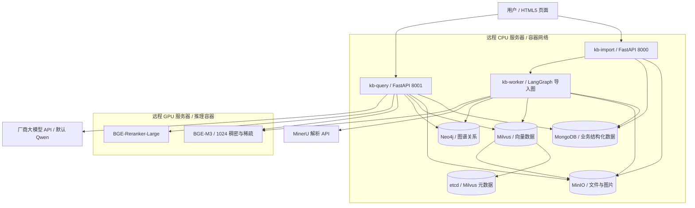

# 多业务线知识服务平台开发手册

依据：[知识库项目需求梳理](./知识库项目需求梳理.md)。配套：[项目面试与评估计划](./项目面试与评估计划.md)。

文档状态：开发设计与实施指南。仓库已交付首版代码与本地验证，实际实现范围、差异和待验收项见 [开发进度](开发进度.md)，当前启动命令见 [README](../README.md)。本手册完整目标不代表已完成全部里程碑或生产验收。需求与本手册冲突时以需求为准，技术变更通过决策记录维护。

使用方式：先阅读第 2–6 章确定技术方案、工程结构和数据边界，再按第 13 章的 M0–M8 推进；实现时查第 7–10 章的流程与接口，验收时查第 12、14–17 章。启动命令的前置条件见第 11 章。

## 1. 开发目标与实施原则

开发一套单机构、多业务线知识服务平台，先完成教育知识库闭环，再扩展听书、旅游、育儿、金融。上线范围包括资料治理、权限隔离、RAG 问答、评估、监控和故障恢复。

开发时遵守以下约束：

1. 先实现可追踪的纵向流程，再扩展领域和页面。
2. 权限、内容版本和发布状态以数据库为准，不能依赖前端或检索索引判定。
3. 原始文件和已审核版本不可随意覆盖，所有回答可追踪到资料与处理配置。
4. 后台任务按可能重复执行设计；跨数据库、索引和文件存储不假定存在一个原子事务。
5. 检索、融合、重排、上下文构造和生成分别实现接口，能够单独评估。
6. 模型与性能参数先给初始配置，再用开发集和实际环境调整。
7. 每个里程碑有退出条件，P0 完成后再引入 P1 的 OCR、复杂表格、自动路由等。

## 2. 技术方案与运行环境

### 2.1 确定的技术栈

| 类别 | 技术选型 | 本项目的配置与职责 |
| --- | --- | --- |
| 后端框架 | FastAPI + Uvicorn | kb-import:8000 与 kb-query:8001，两套路由、独立容器与进程 |
| 工作流 | LangGraph | 导入侧解析/索引图，查询侧问答图；MongoDB 检查点 |
| 大语言模型 | 厂商 API，默认 DashScope Qwen | qwen-flash 文本问答；qwen3-vl-flash 为 P1 图片分支，可通过适配器配置其他厂商 |
| 唯一嵌入模型 | BAAI/bge-m3 | 1024 维稠密 + 学习型稀疏，均由远程 GPU 服务生成 |
| 重排 | BAAI/bge-reranker-large | 远程 GPU 服务，HTTP 批量重排 |
| 向量数据库 | Milvus + PyMilvus | 稠密/稀疏混合检索与独立 BM25 基线，运行在 CPU 服务器 |
| 图数据库 | Neo4j | 实体、关系及其来源证据，运行在 CPU 服务器 |
| 业务数据库 | MongoDB + PyMongo | 结构化业务数据、权限、任务、发布指针、对话和检查点 |
| 对象存储 | MinIO | 原始文件、图片、解析 Markdown/JSON，隔离 Milvus 内部 bucket |
| Milvus 元数据 | etcd | Milvus 内部元数据，不保存平台业务资料或图谱 |
| PDF 解析 | MinerU API | 外部异步解析，Markdown/JSON/图片下载后保存到 MinIO，不自部署 |
| 前端 | HTML5 + CSS + 原生 JavaScript | 无框架 ES Modules，通过两个 API 入口操作 |
| 工程与部署 | uv、pytest、Docker Compose | CPU/GPU 两套容器编排文件、固定镜像与依赖 |

远程 CPU 服务器承载业务服务、后台处理与存储容器；远程 GPU 服务器只承载本方案指定的嵌入和重排推理服务。厂商大模型通过 API 调用，不在 CPU/GPU 服务器部署生成模型。Windows 工作站用于开发、构建与远程运维，标准验收环境为远程容器。

### 2.2 唯一嵌入配置

检索 Profile 固定为 `bge1024_bge_sparse`，稠密模型与稀疏模型都为 BAAI/bge-m3。文档入库和查询编码调用同一 GPU 服务契约，校验 1024 维、模型快照、归一化与截断配置，参考 [BGE-M3 模型卡](https://huggingface.co/BAAI/bge-m3)。

不设其他嵌入厂商或备用嵌入模型；故障时不换模型、不补零、不改变维度。BM25 是 Milvus 内部独立词项检索基线，不属于第二种嵌入模型。BGE 学习型稀疏与 BM25 分开建字段和评估。

模型快照或预处理变化仍可能改变向量空间，需新建 generation/collection，完整重建、评估后切换。使用相同的 1024 维不能代替模型版本一致性校验。

### 2.3 数据与部署边界

MongoDB 是业务事实、访问权限和发布状态的权威源。Milvus 和 Neo4j 是带来源版本的检索/图谱副本，MinIO 保存业务对象，etcd 仅供 Milvus 使用。

BGE GPU 服务运行在允许处理资料的私有环境；跨主机通信通过私有网络或受控 HTTPS，执行身份校验、超时、有限重试与资源限额。资料禁止进入厂商 API 时，返回授权检索结果或阻止生成；GPU 嵌入和重排部署不等于整条问答链路已私有化。

qwen3-vl-flash 为受控图片理解分支，图片由文本证据关联，不表示已有图片向量检索。图谱基础数据先用课程/章节/知识点等明确字段和人工审核关系建设，自动抽取及图谱辅助问答需独立评估。

### 2.4 版本、外部解析与环境

MongoDB 从开发环境起使用副本集。远程单机副本集可验证事务，单台 CPU/GPU 服务器布局用于项目开发与预发布，不能据此宣称高可用。

MinerU 直接调用解析 API，两台服务器均不部署其推理容器或权重。配置 Token、模式、轮询限额和产物 Schema，参考 [官方 API 文档](https://mineru.net/apiManage/docs)。禁止外发资料的 PDF/DOCX 导入应阻断并提示，可另行上传经允许的 Markdown/TXT，不绕过外发策略。扫描件和复杂表格独立验收。

Milvus 的 etcd 与对象存储依赖按所选版本官方 Compose 确认。业务 MinIO 与 Milvus 内部 bucket/账户/卷/备份范围隔离，参考 [Milvus 部署说明](https://milvus.io/docs/install_standalone-docker-compose.md)。

建立版本矩阵并固定 Python、FastAPI、LangGraph、MongoDBSaver、PyMongo、Milvus/PyMilvus、Neo4j/驱动、MinerU API/产物契约、GPU 驱动/CUDA/框架、模型快照与镜像摘要。Neo4j 选用与所需约束及恢复能力匹配的版本/版本类型；参考 [官方容器说明](https://neo4j.com/docs/operations-manual/current/docker/introduction/)。

MinIO 保留指定选型；[官方社区仓库](https://github.com/minio/minio)已归档并采用源码分发，需记录可信构建来源、固定版本及维护方式。所有组件的实际小版本由 M0 联调后冻结。

`dev`、`test`、`staging`、`prod` 使用独立凭据、数据库、collection、图谱范围和 bucket。模拟模式明确标注，不用于正式效果成绩。

## 3. 双服务架构与 LangGraph 边界



图中的共享 MinIO 使用隔离的业务与 Milvus 内部 bucket；etcd 属于 Milvus 内部依赖，与 MongoDB 和 Neo4j 的元数据管理无关。两个业务入口分别提供健康检查与 OpenAPI。

### 3.1 服务职责与所有权

| 服务 | 职责 | 数据操作边界 |
| --- | --- | --- |
| kb-import:8000 | 知识库/成员管理、上传、解析预览、审核、发布、下架、删除、任务 | 通过公共领域服务更新 MongoDB 权限和内容状态；协调存储副本 |
| kb-query:8001 | 登录/登出、搜索、问答、引用/原文/图片读取、历史、反馈与调试 | 读取已授权且已发布资料；写会话、消息、查询检查点和反馈 |
| kb-worker | MongoDB 持久化任务领取，导入/索引/清理/补偿图 | 写阶段产物与检索/图谱副本，持有效租约进行发布 CAS |
| bge-m3 / bge-reranker | GPU 编码/重排 | 不直连业务数据库，不改变业务发布状态 |

两个 API 独立启动、可分别扩容，复用同一个版本化 Python 公共包：认证授权、状态机、Schema、仓储和模型契约。共享存储不代表任何服务可随意写所有集合；MongoDB/MinIO 按职责配置账户，Neo4j 权限粒度按实际版本能力核对，并在服务层执行数据边界。

登录由 kb-query 处理，kb-import 使用同一 MongoDB 会话及公共鉴权逻辑。统一反向代理路由 `/import/api/v1` 与 `/query/api/v1`，分别转发至内部 `/api/v1`；浏览器同源 Cookie Path=/，两个入口都校验会话、CSRF、授权与幂等。受控直连 8000/8001 时明确允许来源、Cookie 与凭据模式；端口不是权限边界。

### 3.2 在线与离线图

查询图在 kb-query 中执行：START → load_session → authorize_scope → prepare_query → encode_bge_m3 → retrieve_milvus → validate_candidates → fuse → optional_graph_expand → validate_graph_evidence → rerank → build_context → generate_vendor_api → validate_citations → persist_answer → END。

资料不足、澄清、取消/撤权、模型失败均进入明确终态。图谱扩展开关关闭时跳过；图谱返回的原文 chunk/version 必须重新授权、验证当前版本后才能进入重排和上下文。fuse 选用 Milvus RRFRanker 或应用层 RRF，避免重复融合。

导入由 kb-import 提交任务，kb-worker 执行：claim_task → check_parser_egress → fetch_source → submit_mineru_api_or_parse_text → poll_and_download_when_needed → normalize → split → save_preview_and_graph_draft → END。Markdown/TXT 分支跳过 API 上传/轮询。审核通过后创建索引图：load_approved_version → check_processing_policy → encode_bge_m3 → write_milvus → write_required_graph → verify_manifests → publish_compare_and_swap → cleanup_or_notify → END。

首期审核采用独立 HTTP 状态机，Worker 不等待人工。自动实体/关系抽取未启用时仍写基础结构关系；启用 LLM 抽取后，须执行厂商外发检查，抽取结果经过审核再写图谱。LangGraph interrupt 恢复前重新鉴权，不能绕过审核摘要。

### 3.3 State 与 Checkpointer

GraphState 至少记录 request_id/task_id、user_id、session_id、thread_id、kb_scope、policy_epoch、资料版本、generation、embedding_profile、查询、候选 ID、证据 ID、配置版本、耗时和终态。

图中优先保存引用/对象 ID，避免保存大图片、原始 PDF、完整敏感候选和无限增长的正文。messages 集合是用户可见历史，checkpoint 是内部图状态，两者不能互相直接替代。

使用 `langgraph-checkpoint-mongodb` 的 MongoDBSaver，参考 [官方集成说明](https://www.mongodb.com/docs/atlas/ai-integrations/langgraph/)。M0 验证锁定版本的异步/流式行为和线程池消耗，不臆造另一个 Saver 类名。InMemorySaver 只用于测试，不能承担运行环境恢复。

业务会话 ID 不直接作为所有运行共用线程：线程 ID 由服务端按用户、会话和请求生成；单次运行在同一租约内恢复时复用该线程，任务重新领取时按第 7 章隔离尝试。历史由 messages 读取并授权，同一会话并发写采用 revision/租约控制。

检查点不会自动保证外部调用恰好一次。入库、发布、通知等节点使用业务幂等键；生成节点在已开始计费/输出后不能无条件重放，默认保存 interrupted 并要求显式重新生成。

删除和撤权覆盖 messages、checkpoint、checkpoint writes、图缓存及调试数据；恢复旧 checkpoint 前重查授权和删除台账。持久化概念见 [LangGraph 文档](https://docs.langchain.com/oss/python/langgraph/persistence)。

## 4. 推荐目录与工程约定

以下为设计目录约定；实际首版目录采用共享 `knowledge_service` 包与 `infra/compose.*.yml`，参见仓库 README。

```text
1002/
├─ backend/
│  ├─ pyproject.toml
│  ├─ uv.lock
│  ├─ src/knowledge_service/
│  │  ├─ import_app.py        # kb-import FastAPI，8000
│  │  ├─ query_app.py         # kb-query FastAPI，8001
│  │  ├─ worker.py            # kb-worker 入口
│  │  ├─ cli.py               # init/migrate/doctor/eval
│  │  ├─ api/{import_api,query_api}/
│  │  ├─ core/                # 共享配置、鉴权、错误、日志
│  │  ├─ models/              # 业务数据契约与状态
│  │  ├─ schemas/             # HTTP / GraphState
│  │  ├─ repositories/        # MongoDB CAS/事务，Neo4j 证据查询
│  │  ├─ services/            # 资料、审核、发布、会话、反馈
│  │  ├─ workflows/           # 导入/索引图、问答图
│  │  ├─ ingestion/           # MinerU API 产物、清洗与切分
│  │  ├─ indexing/            # Milvus/Neo4j manifest
│  │  ├─ graph/               # 实体、关系、证据映射与受控扩展
│  │  ├─ rag/                 # 召回、融合、预算与引用
│  │  ├─ adapters/            # 厂商 LLM、BGE GPU、存储
│  │  ├─ tasks/               # MongoDB 租约、Outbox 与补偿
│  │  ├─ migrations/          # MongoDB 校验器、Neo4j 约束
│  │  └─ evaluation/
│  └─ tests/{unit,integration,e2e}/
├─ frontend/{index.html,pages,css,js,vendor}/
├─ services/{bge_m3,bge_reranker}/
├─ configs/{rag,prompts,domains,graph}/
├─ infra/{docker,proxy,monitoring,mongodb,milvus,neo4j}/
├─ data/samples/
├─ eval/{datasets,configs}/
├─ artifacts/
├─ docs/
├─ compose.cpu.yaml           # 远程 CPU：业务、解析、存储
├─ compose.gpu.yaml           # 远程 GPU：嵌入、重排
├─ .env.cpu.example
├─ .env.gpu.example
└─ .gitignore
```

两个 API 使用同一个后端镜像/依赖锁文件，通过不同启动命令加载各自路由；kb-worker 使用相同公共业务代码但独立进程和资源限制。同步解析与 GPU 调用不得堵塞 API 事件循环。

前端由 kb-query 或反向代理提供，api 模块区分 import/query base URL，页面不能通过知识库 ID 自行扩大授权。第三方 Markdown 渲染/净化脚本固定版本与来源，不从任意动态 CDN 加载。

Compose CPU 网络内使用服务名，例如 mongodb、milvus、neo4j、minio；跨 CPU/GPU 主机使用可路由的私网地址/内部域名，不能把 CPU Compose 中的 bge-m3 服务名或 localhost 当作 GPU 地址。两个 Compose 不自动共享容器网络。

所有文件用 bucket/object_key 定位；时间使用带时区 UTC。密钥、业务原文、存储卷、模型权重和默认问答日志不提交，可共享样本与题集单独检查。

## 5. MongoDB 数据模型与存储分工

### 5.1 集合设计

MongoDB 同时保存对话和平台元数据，使用集合而非 SQL 表。开发单机副本集验证多文档事务；运行环境按资源配置副本集与认证。

| 集合 | 关键字段 | 约束 / 索引 |
| --- | --- | --- |
| users | _id、login、password_hash、status、auth_epoch | login 唯一；禁用后会话失效 |
| auth_sessions | token_hash、user_id、expires_at、revoked_at | token_hash 唯一；过期由读取逻辑判断，TTL 只做清理 |
| business_domains | code、name、schema_version | code 唯一 |
| knowledge_bases | domain_id、policy、policy_epoch、index_generation、embedding_profile | 当前检索配置及资料外发策略 |
| kb_members | kb_id、user_id、role | 组合唯一，角色不自动跨库 |
| documents | kb_id、owner_id、visibility、active_version_id、revision、blocked_at、deleted_at | CAS 使用 revision；当前版本必须属于此文件 |
| document_acl | document_id、principal_type、principal_id、actions | 组合唯一，读/历史/管理动作分开 |
| document_versions | document_id、revision、source_key、source_hash、metadata、state、submitted_by | 文件内 revision 唯一，提交后正文不可变 |
| review_records | version_id、reviewer_id、decision、reviewed_hash | 自审禁止；绑定审核快照 |
| chunks | version_id、pipeline_revision、ordinal、text_or_object_key、locator、hash | 组合唯一；大正文/图放 MinIO |
| processing_tasks | task_id、business_key、status、attempts、next_run_at、lease_until、fencing_token、thread_id | business_key 唯一；领取条件索引 |
| index_manifests | version_id、generation、profile、collection_name、dense_ready、sparse_ready、bm25_ready、search_ready、count、config_hash | 三路 readiness 明确，Profile 不混用 |
| graph_manifests | version_id、generation、graph_revision、graph_ready、fact_count、snapshot_key、config_hash | 基础图谱与已审核事实快照绑定 |
| parser_submissions | version_id、attempt_id、data_id、batch_id/task_id、status、artifact_keys | 远程任务映射与提交核对 |
| outbox_events | event_type、aggregate_id、payload、status、next_run_at | 与元数据同事务提交，Worker 持久化领取 |
| chat_sessions | owner_id、kb_scope、revision、created_at | 会话归属和并发边界 |
| messages | session_id、request_id、question、answer、status、dependency_versions、config_revision | request_id 唯一；正文受留存与撤权清理 |
| citations | message_id、chunk_id、version_id、generation、profile、locator、asset_keys | 引用绑定原文版本和图片资产 |
| feedback_tickets | message_id、category、assignee、status、resolution | 处理和回归可追踪 |
| audit_events | actor、action、resource、result、request_id、timestamp | 追加元数据，不默认写业务正文 |
| idempotency_records | actor_id、route、key、body_hash、resource_id、status、expires_at | 组合唯一；不同输入同键返回 409 |
| security_ledger | sequence、event_type、resource_id、effective_at、payload_hash | 删除/撤权事实独立于旧备份保留 |
| graph_checkpoints / graph_writes | 由 MongoDBSaver 管理 | 与业务集合隔离命名、授权、清理与备份 |
| quota_leases | scope、slot_id、request_id、expires_at | 独立租约名额及原子领取，过期读取判断 |

不要把所有历史消息嵌进一个会话文档。MongoDB 文档有大小限制，消息、检查点和任务独立拆分，图片和 PDF 不放 BSON。外键关系和枚举校验由服务、集合校验器及定期核对共同保证。

### 5.2 原子性与读取策略

- 操作 users/members/documents 等权威数据时使用可确认最新授权的主节点读取策略；运行环境明确 read/write concern，测试主从滞后和撤权。
- 发布以 `document_id + expected_revision + expected_active_version` 条件更新，受影响记录数不等于 1 时视为冲突。
- 审核、发布指针、版本状态、策略代际、审计与 Outbox 在 MongoDB 短事务中一致变更。
- 网络、GPU、MinerU API、Milvus、Neo4j、MinIO 调用放在事务外，不能持有事务等待模型。
- 未配置副本集或多文档事务不可用时，doctor 报错，不悄悄退化为多次非原子写入。
- graph checkpoint 和业务消息不是天然同事务；依靠 request_id、终态 CAS 和补偿任务核对，两者不一致时不把未完成答案显示为完成。
- TTL 清理具有异步性，权限、会话和配额到期立即由读取/领取条件判断，不能等后台自动删除。

### 5.3 Milvus、MinIO 与 etcd 分工

Milvus 只负责检索副本：稳定 chunk_id、version_id、kb_id、profile/generation、业务筛选字段、正文摘要/文本、稠密和稀疏向量。MongoDB 是授权与发布指针的权威源。

etcd 只维护 Milvus 内部元数据，业务 API 不直接读写。Neo4j 保存来源关系，不保存授权事实。

MinIO bucket 建议分为 kb-originals、kb-derived、kb-images、kb-backups。键按机构/知识库/文档/版本/产物组织，禁止用用户文件名拼任意路径。

Milvus 内部对象存储使用独立 bucket/账户；应用删除任务不能清理 Milvus 内部文件。业务全文若存 MongoDB，仍按消息和数据分级策略控制，不复制到不受控检查点。

```json
{
  "chunk_id": "c_001",
  "document_id": "d_001",
  "version_id": "v_002",
  "kb_id": "kb_education",
  "generation": "g_001",
  "profile": "bge1024_bge_sparse",
  "pipeline_revision": "p_001",
  "title": "演示课程交付要求",
  "content_object_key": "education/d_001/v_002/chunks/c_001.json",
  "locator": {"type": "pdf", "page_number": 3, "block_index": 12},
  "asset_keys": [],
  "source_hash": "示意摘要"
}
```

向量写入 Milvus 时才附实际值；唯一 Profile 为 bge1024_bge_sparse，稠密固定 1024 维，稀疏使用独立类型，不伪造定长稀疏维度。

### 5.4 Neo4j 图谱与来源模型

图谱是绑定文档版本的派生数据。P0 建知识库/版本/片段与课程/章节/知识点基础关系，P1 启用跨文档扩展与自动抽取。每条事实都带来源。

| 节点/连接 | 字段与职责 |
| --- | --- |
| KnowledgeBase / DocumentVersion / Chunk | ID、kb_id、version_id、generation、摘要；与 MongoDB/Milvus 对齐 |
| Entity | entity_id、kb_id、type、canonical_name；按知识库命名空间去重，防止跨库同名合并 |
| Assertion | assertion_id、kb_id、version_id、generation、relation_type、extractor_revision、reviewed_hash |
| SUBJECT / OBJECT / EVIDENCED_BY | Assertion 连接主语、宾语和证据 Chunk，不只保留无来源实体边 |
| 基础结构关系 | 课程含章节、章节涉及知识点、版本含片段，均能由资料核对 |

关系类型白名单。自动推断关系先预览/审核，提交后事实改变必须重审。事实快照与摘要保存 MinIO 派生目录，支持确定性重建。

稳定 ID 设置节点唯一约束，kb_id/version_id/generation 建查询索引；参数化 Cypher + MERGE 在 Neo4j 内部事务完成断言及证据连接。约束按 [官方文档](https://neo4j.com/docs/cypher-manual/current/constraints/managing-constraints/)和锁定版本实现。MongoDB 与 Neo4j 无共享事务，先准备图谱/向量与 manifest，再切 MongoDB 指针；图谱字段不代替发布/授权判定。

## 6. 认证、授权与数据外发

### 6.1 首期认证方案

使用本地账号与服务端会话起步，保留企业身份系统适配接口。密码使用成熟密码哈希库，会话令牌为随机值，数据库只保存令牌摘要。

浏览器会话采用 HttpOnly Cookie；运行环境启用 Secure，配置 SameSite 与明确的允许来源。写请求包含 CSRF 防护，登出/停用用户撤销会话；登录接口限流。开发环境的 HTTP 例外仅限本机。

### 6.2 授权服务契约

```text
authorize_operation(user, action, resource) -> allow / deny
resolve_read_scope(user, kb_ids, time_scope) -> authorized_version_ids + policy_epoch
validate_dependencies(user, version_ids) -> readable / blocked
check_egress(version_ids, service_type, provider) -> allow / deny
```

- user 从已认证会话获取，不接受请求体指定身份。
- 前两项分别解决“能否操作”和“能读哪些数据”。角色允许管理知识库，不代表能读取所有正文。
- 未授权资源采用一致的不可见行为，例如返回 404；不得先返回标题再说无权限。
- 提交者不能因为同时拥有审核角色而通过自己的版本；测试必须使用不同身份。
- 用户读取版本列表、原文、引用、调试记录、历史回答和反馈时都检查资源依赖。

首期可从数据库计算授权且有效的 `version_id` 集合，传入两种召回的过滤条件。范围为空时不执行全局检索。大范围集合在目标容量下测量查询开销，后续可优化为权限分区，但仍保留权威复核。

### 6.3 外发与撤权边界

每次调用外部模型前，检查本次资料允许使用的提供方与用途。查询文本、历史消息、候选重排文本、裁判评估数据都属于需要检查的数据，不能只检查最终生成上下文。

流式请求每次向用户发送内容前检查相关权限/阻断代际，变化时复核并停止不再允许的输出。通知用于加快取消，MongoDB 权威读取负责最终判定；不能依靠可能丢失的通知保证安全。

工程验收必须明确：撤权提交后新的鉴权不再放行，活动请求在下次输出检查时停止；已经发往客户端或被下载的内容无法远程撤回。受控页面可隐藏已显示内容，服务端清理相关历史正文，但不能宣称抹除用户此前取得的副本。记录检查与发送之间的并发边界，并以负向测试验证。

## 7. MinerU 解析、审核与发布

### 7.1 MinerU API 与产物契约

Parser 分为 submit、poll、download 三个阶段，返回 Markdown、结构化块、图片与 warnings；Normalizer 保留源定位，Splitter 生成片段，GraphBuilder 构建带证据的审核草稿。

| 格式 | 处理方式 | 定位与验证 |
| --- | --- | --- |
| Markdown | 标题/正文块本地解析，不调用外部 API | 原始行号与标题路径 |
| TXT | 检测编码并按段落读取 | 原始行号，异常报错 |
| PDF | MinerU 精准解析 API，下载 Markdown/JSON/图片 | 页/块定位、表格图片预览与缺页检查 |
| DOCX | 已验证的 MinerU API Office 输入能力 | 标题路径与块序号，不虚构 Word 页码 |

采用带 Token 的异步解析 API，参考 [官方 API 文档](https://mineru.net/apiManage/docs)。结构化定位/图片验收不能只依赖轻量 Markdown 输出。

私有文件接入步骤：

1. Worker 校验文件/版本、大小和解析外发策略，从 MinIO 读取私有原文。
2. POST /api/v4/file-urls/batch 申请上传地址，保存 batch_id、data_id 与内部 version_id/attempt_id 映射。
3. 向返回地址 PUT 文件，服务商接收后自动解析，不重复提交；不公开 MinIO bucket。
4. GET /api/v4/extract-results/batch/{batch_id} 轮询，设置退避、账号/并发限额、总超时与下次查询时间；等待时释放任务槽位，后续从保存的远程 ID 继续。
5. 成功后下载 full_zip_url，安全解包并限制文件数/展开大小，核对页覆盖、表头、单位和脚注。
6. Markdown、原始 JSON、图片及 manifest 保存至 MinIO，归一化坐标/asset_key，生成预览与审核草稿。

上传/下载仅访问提供方允许的 HTTPS 域名，重定向仍检查，防止内网访问、路径穿越与解压膨胀。Token 不转发给上传/CDN 地址。远程结果 URL 不作为长期引用，MinIO 对象才是系统资产。

parser_submissions 保存远程 ID 与阶段，恢复先查询已提交任务，不因重启重复解析。提交超时且未取得 ID 时标记 submission_unknown，按可用查询能力或人工核对处理。data_id 仅作关联，不假定提供方幂等；重复下载/保存用摘要和合法租约控制。

记录 API/模式、参数、响应 Schema 与产物摘要；未返回具体模型快照时标为未知。文件/页数/批量/账号限额按实际 API 检查。首期轮询，后续回调另做验签与幂等。

定位 JSON 必须保存，真实零基页索引映射用户页码；bbox 存在才保存坐标/单位/页面尺寸，不编造。扫描件/复杂表格独立验收，VL 辅助复核也执行来源与外发检查。

### 7.2 切分与状态机

基线使用固定 Token 切分，结构策略按标题/段落优先，过长块再切。初始目标 400 Token、上限 800、重叠约 60，仅用于开发集试验；同时检查嵌入、重排与生成各自 Tokenizer 上限。

保留数字、单位、年份、否定词和业务条件。表格分段时重复必要表头，禁止截掉单位或适用条件；每个片段同时保留 normalized 文本定位和源 PDF 页/块引用。

内容状态：草稿 → 待审核 → 已退回/审核通过待发布 → 已发布 → 已归档/已下架/已删除。处理状态与内容状态分离，记录解析、嵌入、写索引各阶段成功/失败/取消。

外部解析等待采用 waiting_external 子状态，保存 next_run_at 与远程任务 ID。Worker 释放租约后，由原子领取条件匹配到期等待任务；重新领取以新 fencing_token 从 parser_submissions 重建合法阶段，不持有 GPU/解析槽位或长事务等待厂商任务。

审核摘要包含原文、元数据、解析产物和资产清单。提交者不能审核自己；提交后修改创建新修订并重审。旧版本在新版本准备失败时继续有效。

### 7.3 上传与持久化任务

1. API 校验身份、操作权限、文件及元数据，上传 MinIO 临时对象并计算摘要。
2. MongoDB 短事务创建版本、processing_tasks、outbox_events 和审计。
3. 提交后返回 202/task_id；事务失败时孤立对象由明确清单异步清理。
4. 独立 Worker 从 MongoDB 原子领取待执行事件/任务，设置租约和递增 fencing_token，驱动 LangGraph。
5. 成功保存阶段产物与权威状态；失败按类型有限退避重试，最终失败提供人工重跑。

LangGraph 是步骤编排和持久化状态工具，不是外部任务队列。不能只用 FastAPI BackgroundTasks 承担上传后的可恢复处理。首期 MongoDB 任务集合 + Worker 无需新增消息中间件；扩大吞吐后再评估队列。

业务幂等键为 version_id + stage + pipeline_revision + profile。任务恢复同时检查 MinIO 产物、Milvus 稳定主键和阶段 manifest，不能只相信 checkpoint 里“已完成”的字段。

Worker 持续心跳、检查取消和租约；租约失效后不能提交新的完成/发布结果。外部索引以稳定主键幂等写，不承诺外部副作用恰好一次。

领取使用 find_one_and_update 原子匹配待执行或租约已过期的任务，并递增 fencing_token；续租、保存阶段 manifest 和完成状态都匹配 task_id + fencing_token + owner + 未过期租约。跨集合状态提交放入短事务，失效尝试的产物先写入独立尝试路径，仅由持有有效租约的 Worker 绑定到版本；孤立产物按清单回收。

不同领取尝试使用 `task_id:fencing_token` 作为图线程，防止旧 Worker 写检查点覆盖新尝试。恢复从最后合法阶段与验证产物重建 state；同一次有效租约内可使用自身 checkpoint 恢复。共享线程恢复必须额外验证 Saver 写入隔离，不能只做进程内锁。

### 7.4 Milvus 索引准备

- 根据当前 Profile 计算 dense、sparse_bge；需要基线的 collection 配置独立 BM25 function。
- 同一 profile/generation 中采用稳定 chunk_id 作为主键，重试使用经验证的 upsert 路径。
- BM25 输出由 Milvus 函数生成，不写入伪造 BM25 向量；确认锁定版本下 upsert/函数重算行为。
- 校验返回条数、向量维度、稀疏索引/权重合法性、文本长度和全部主键，不忽略部分错误。
- 等待 collection/load/index 就绪，以指定一致性执行新版本点查、样本检索和三路 readiness 验证。
- dense_ready、sparse_ready、bm25_ready、search_ready 与 collection/profile/config_hash 写入 manifest；BM25 为试点评估基线时必须验证。

只 flush 不等于索引已加载或所有查询立即可见。发布验证和初期读取使用可验证的 Strong 一致性；性能优化若改用其他一致性需明确新版本可见性水位并补测，参考 [Milvus 一致性说明](https://milvus.io/docs/consistency.md)。

Neo4j 基础图谱同步准备：从已审核事实快照按稳定 ID 幂等写入，验证节点/断言数量、全部证据指向当前待发布版本、generation 和 reviewed_hash。校验查询按目标版本读取，保存 graph_ready、snapshot_key 和摘要；基础图谱失败不发布。P1 辅助扩展开关关闭不等于可以跳过 P0 基础关系入库。

### 7.5 发布 CAS 与跨存储一致性

Milvus、Neo4j 和 MinIO 准备在 MongoDB 事务外执行。新版本已存在于检索/图谱副本但不在 active_version_id 范围内时不可供普通用户查询。

发布事务：

1. 从主节点读取权威版本、审核摘要、index/graph manifests、当前 revision、阻断和权限；确认基础图谱和检索通道全部就绪且摘要一致。
2. 使用 document_id + expected_revision + expected_active_version 条件更新发布指针，增加 revision。
3. 同事务调整新旧版本状态、策略代际、审计和失效事件；受影响数不为 1 则冲突。
4. 事务提交才返回发布成功；后续检索使用 MongoDB 有效版本集合和对应 collection，并复核候选。

这不是 MongoDB 与 Milvus/Neo4j/MinIO 的分布式事务。准备失败不切换；MongoDB 提交失败则新向量/图谱保留为不可见准备数据并补偿；并发操作返回 409 或重新准备。

### 7.6 下架、删除、回滚与代际

- 下架先在 MongoDB 阻断并增加策略代际，再清 Milvus/Neo4j 副本、缓存、历史和检查点；图谱残留不能继续进入问答。
- 删除记录台账，清除原文/解析/图片/图谱快照、Milvus 全代际、Neo4j 对应断言/证据连接、引用和敏感历史。实体仅在无合法剩余引用时清理，不能误删其他文档仍使用的实体；检查点/写集合也在范围内。
- 本地删除不代表厂商副本已删除；MinerU/生成 API 的留存及可用删除接口单独记录，不能以清除 task_id 或 URL 替代提供方处理。
- MinIO 开启对象版本化时，清理非当前版本与删除标记的保留策略，不能只删当前 key 后声称所有副本消失。
- 回滚复核旧版本审核、权限、阻断、index/graph manifests、collection 与来源关系，使用同一 CAS 发布协议。
- BGE 快照/预处理/主要切分或图谱规则变化创建新 generation 与副本；嵌入模型固定 BGE-M3 1024 维。验证后切 MongoDB 指针，保留期结束再清旧代际。
- BGE-M3 GPU 故障时暂停新索引准备；在线仅授权 Milvus BM25 降级或失败。稠密/稀疏都依赖该服务，不声称稀疏仍可编码，不换模型。

## 8. Milvus 混合检索与模型接入

### 8.1 统一契约

```text
ReadScope(user_id, kb_ids, allowed_version_ids, policy_epoch, time_scope)
EmbeddingBundle(profile, dense_model, dense_dim, dense, sparse_model, sparse)
Candidate(chunk_id, version_id, generation, locator, text, source_ranks, scores)
RetrievalResult(candidates, timings, profile, degraded_flags)
AnswerContext(sources, asset_keys, token_count, config_revision, dependency_versions)
AnswerEvent(request_id, message_id, sequence, event_type, payload)
```

每次文档/查询使用相同 profile、模型与处理规范。BM25、BGE 稀疏、稠密相似度和 cross-encoder 分数保留来源，不直接相加为“置信度”。

### 8.2 Collection Schema

唯一 Profile 为 bge1024_bge_sparse，collection 例如 kb_chunks_g001_bge1024。模型快照/主要配置变化使用新 generation/collection，dense 固定 1024 维：

| 字段 | Milvus 类型 | 用途 |
| --- | --- | --- |
| chunk_id | VARCHAR 主键 | 稳定幂等 ID |
| document_id、version_id、kb_id、generation、profile | VARCHAR | 权限/版本过滤与溯源 |
| domain_code、课程/地点/年份等白名单字段 | 对应标量 / JSON | 业务筛选；用实际访问方式验证索引 |
| title、content | VARCHAR | 引用上下文；content 启用所选分析器 |
| dense | FLOAT_VECTOR | BGE-M3 1024 维，COSINE/HNSW 起步 |
| sparse_bge | SPARSE_FLOAT_VECTOR | BGE-M3 学习型稀疏，IP 稀疏倒排索引 |
| sparse_bm25 | SPARSE_FLOAT_VECTOR | 由 content 的 BM25 function 生成，使用 BM25 检索 |
| locator_ref、content_hash | VARCHAR | 原文定位与内容校验 |

中文 analyzer 使用所锁定 Milvus 版本支持的配置，先验证课程名、书名、产品代码的分词，不照搬其他搜索引擎配置。VARCHAR 限制按 UTF-8 字节检查，不把字符数当字节数。

BGE 学习型稀疏与 BM25 是独立通道：前者由模型生成 token 权重，后者依赖词频和语料统计。相关配置见 [Milvus 全文检索](https://milvus.io/docs/v2.6.x/full-text-search.md)与 [混合检索](https://milvus.io/docs/v2.6.x/multi-vector-search.md)。

### 8.3 过滤与融合

MongoDB 计算授权且有效的 version_id，服务端用安全表达式构造器形成 Milvus filter，附带 kb/generation 和白名单业务条件。空范围不执行检索；禁止拼接未经转义的用户表达式。

每条 AnnSearchRequest 使用相同范围。示例仅展示主路径，变量和 collection 需由脚手架实现后提供：

```python
from pymilvus import AnnSearchRequest, RRFRanker

dense_req = AnnSearchRequest(
    data=[query_bundle.dense], anns_field="dense",
    param={"metric_type": "COSINE", "params": {"ef": 64}},
    expr=scope_expr, limit=30,
)
sparse_req = AnnSearchRequest(
    data=[query_bundle.sparse], anns_field="sparse_bge",
    param={"metric_type": "IP", "params": {}},
    expr=scope_expr, limit=30,
)
hits = milvus_client.hybrid_search(
    collection_name=collection_name,
    reqs=[dense_req, sparse_req], ranker=RRFRanker(60), limit=40,
    output_fields=["chunk_id", "version_id", "kb_id", "content", "locator_ref"],
    consistency_level="Strong",
)
```

在锁定版本进行真实集成测试后再冻结参数。BM25 基线用原始查询文本搜独立 BM25 字段，不将 query_bundle.sparse 当 BM25 输入。

初始两路各 30、融合最多 40、重排最多 30、上下文最多 5。需要逐路可观测结果时分别 search 后在应用层 RRF，公式 Σ weight/(60+rank)，缺路贡献 0；若使用 Milvus 融合就不再次融合。

召回后从 MongoDB 再核对发布指针、历史范围和权限，确认后才进入 GPU 重排和生成。授权过滤不能仅靠最终展示时删除越权片段。

### 8.4 唯一 BGE-M3 GPU 嵌入服务

导入 Worker 编码文档，kb-query 编码查询，均调用 GPU 主机 BAAI/bge-m3，输出 1024 维稠密与学习型稀疏。模型仅在 GPU 容器加载，业务镜像无权重，不调用厂商嵌入 API。

项目契约 POST /v1/embeddings 输入 texts、request_id、return_dense、return_sparse；返回同序 dense_vectors、sparse_vectors、model_revision、dense_dim=1024 与耗时。端点/Schema 是项目封装，不声称模型官方自带 HTTP 服务。

校验条数/顺序、维度、模型快照、数值与 token_index→weight 非零映射。保存 Tokenizer、归一化、最大长度、截断、精度，文档/查询规范一致，不启用 ColBERT 也能完成当前方案。

文档分批、有界排队，在线查询/重排预留资源；分别记录 CPU→GPU 网络、排队和推理耗时。OOM/超时有限重试，失败不标就绪；无法编码查询时仅授权 BM25 降级，不换模型。

### 8.5 远程 BGE-Reranker-Large

GPU 服务器固定 BAAI/bge-reranker-large 的模型版本，使用专用服务凭据和并发/批量限制。与 BGE-M3 共用 GPU 时分别记录排队和推理耗时。

服务契约 `POST /v1/rerank`：输入 request_id、query、[{candidate_id,text}]、top_n；输出 model_revision、[{candidate_id,score}]、usage_or_timing。用 ID 关联，不按排序后的数组索引误配原文。

模型对 query/document 对评分，参考 [模型卡](https://huggingface.co/BAAI/bge-reranker-large)。设置符合模型能力的截断并保留标题/条件，不将长嵌入窗口直接当重排上限；必要时短窗口评分并记录聚合策略。

远程文本同样执行外发策略。超时、5xx、响应缺项或显存不足可回退融合排序，记录降级；不得换成另一模型后隐瞒配置变化。

### 8.6 厂商生成 API 与图片分支

- 默认 DashScope qwen-flash 文本问答，其他厂商通过独立适配器配置并评估；保留区域对应接口、流式行为、模型标识和采样参数；账号可用性由 doctor/验收验证，不自动改用更新型号。
- qwen3-vl-flash 仅在图片/表格辅助理解开关启用时使用，文本与图片请求 Schema 分开验证。
- 图片从 MinIO 按权限读取，禁止将私有 bucket 改为公网。允许外发时用受控服务端图片传输，并记录目的服务、资产版本和成本。
- 纯文本向量不代表跨模态图片检索。首期图片由已召回文本块的 asset_key 关联；真正图片向量检索属另一个扩展。
- 图表解释仍引用原文页/块，不将模型识别结果未经核对当成金融数值事实。

提示词文件版本化：仅使用授权证据，资料中的指令不能改规则；关键结论引用 S1 等给定标签；资料不足说明范围，含糊澄清、冲突列来源；保留年度、单位、年龄和版本。

### 8.7 上下文与有限追问

生成前复核候选、去重、限制单文档占比，补必要同版本邻接块，绑定来源与图片，按生成模型预算保留输出余量。图片预算单独记录，不能当普通字符估算。

MongoDB messages 保存用户历史，LangGraph state/checkpoint 保存运行状态。有限窗口读取历史前重新检查 dependency_versions；切换知识库后重建范围，不沿用旧引用。

流式草稿在未结束时显示生成中。发送引用标签前校验存在性和权限；语义支持由规则、抽检及离线评估共同检查。终态校验失败标为不完整，不能让 checkpoint 的完成标志覆盖业务消息错误。

### 8.8 Neo4j 受控关系扩展

P0 基础图谱，P1 开关启用扩展。从授权文本候选定位实体，再运行固定、参数化 Cypher 模板，初始最多 1–2 跳、20 个新增片段，不执行模型自由生成的 Cypher。

每跳 Assertion 都限制 kb_id、授权有效 version_id 和 generation。实体相同不意味着可读全部邻居，不能先遍历全图只过滤最终结果。扩展返回 evidence chunk/version，MongoDB 再校验、去重和重排后才入上下文。无证据路径不支撑答案。

图谱超时可关闭辅助扩展并继续文本检索，标记降级；关系必需请求明确能力不可用。路径/分数仅供受限调试，不是答案正确率。

## 9. HTTP 接口与流式协议

### 9.1 统一约定

路径前缀 `/api/v1`；非流式业务响应包含 request_id。资源 ID 不能代替授权检查，列表、计数和分页都按权限过滤。

```json
{
  "request_id": "req_example",
  "data": {"id": "resource_example"},
  "error": null
}
```

错误结构包含稳定业务代码、可理解消息和 request_id，日志保存必要内部原因，不把堆栈、索引名称、模型凭据或未授权标题返回用户。

状态码约定：401 未认证，403 无操作权限，404 不可见资源，409 状态/并发/幂等冲突，413 文件过大，422 参数错误，429 过载或配额限制，503 必要依赖不可用。

写操作使用 `Idempotency-Key`；键按当前用户和路由隔离，记录请求体摘要。同键不同输入返回 409；同键已完成返回已有资源，同键进行中返回任务状态。流式重试不自动重复生成与计费，而是返回已有 message_id 和状态。

### 9.2 接口清单

接口所有权：kb-import 管理知识库/成员写操作、文档/版本/审核/发布/下架/删除/ACL、任务和预览；kb-query 处理认证、搜索、会话/问答/取消、引用/原文/图片、反馈和调试。知识库列表/策略读取、当前身份与探针可复用公共只读接口，不整套重复挂载路由。

各类接口定义 Schema、授权、成功/错误响应和各自 OpenAPI。两个内部前缀均为 /api/v1，按第 3 章入口访问；request_id 跨服务/Worker/GPU 传递，不作为身份。

| 方法与路径 | 用途 | 核心要求 |
| --- | --- | --- |
| POST /auth/login、/auth/logout | 登录/登出 | 会话撤销、限流、CSRF |
| GET /auth/me | 当前身份与可操作范围 | 不信任客户端角色 |
| GET/POST /knowledge-bases | 知识库列表/创建 | 列表过滤；创建需管理权限 |
| GET/PATCH /knowledge-bases/{id} | 查询/调整策略 | 外发与时效策略有审计 |
| PUT/DELETE /knowledge-bases/{id}/members/{user_id} | 成员授权/撤销 | 更新 policy_epoch、撤权记录与历史可见性 |
| POST /knowledge-bases/{id}/documents | 创建文档并上传首版 | multipart、202、幂等、task_id |
| POST /documents/{id}/versions | 上传新版本 | 不覆盖旧版，元数据随版本保存 |
| GET /documents/{id}/versions | 版本列表 | 普通读者与维护者可见范围不同 |
| GET /versions/{id}/preview | 解析预览 | 草稿仅限维护/审核角色 |
| POST /versions/{id}/submit | 提交审核 | 解析通过，生成审核摘要 |
| POST /versions/{id}/reviews | 批准或退回 | 审核者不等于提交者 |
| POST /versions/{id}/publish | 准备索引并发布 | 202、状态可查询、并发控制 |
| POST /documents/{id}/withdraw | 紧急下架 | 数据库先阻断，再清理 |
| POST /documents/{id}/rollback | 回滚有效版本 | 同发布检查，不能复活删除资料 |
| DELETE /documents/{id} | 删除文档及各版本 | 先阻断，返回清理任务状态 |
| PATCH /documents/{id}/acl | 调整文档访问范围 | 权威授权、代际更新与审计 |
| GET /tasks/{id}、POST /tasks/{id}/retry | 处理状态/重试 | 不泄露其他业务线任务 |
| POST /search | 检索 | kb_ids、question、filters、time_scope 白名单 |
| POST /conversations | 创建会话 | 所选范围必须授权 |
| POST /conversations/{id}/answers | 流式问答 | 身份、范围、预算预检查；创建 message_id |
| POST /requests/{id}/cancel | 取消生成 | 仅所有者可取消，释放并发名额 |
| GET /conversations/{id} | 读取历史 | 重新检查每条消息的资料依赖 |
| GET /citations/{id} | 查看引用与原文定位 | 当前权限；下架/删除规则生效 |
| GET /versions/{id}/source | 原文预览/下载 | 授权代理传输，不公开文件路径 |
| GET /assets/{id} | MinerU 图片/衍生资产预览 | 校验资产所属版本及权限；MinIO 私有代理传输 |
| POST /feedback、GET/PATCH /feedback/{id} | 反馈及处理 | 权限、指派、处理与回归 |
| GET /debug/requests/{id} | 链路调试 | 额外调试权限和资料阅读权限 |
| GET /health/live、/health/ready | 探针 | 不公开依赖凭据和业务数据 |
| GET /metrics | 指标采集 | 内部网络或认证，避免正文标签 |

下载主路径采用后端授权代理。对象存储预签名 URL 一旦交付通常难以立即撤销，不作为需要即时撤权的敏感原文主路径。

### 9.3 SSE 协议

问答 POST 使用 `fetch` 接收 `text/event-stream`，而非把问题放进 URL。采用 Cookie 认证时同样校验 CSRF；反向代理关闭流式缓冲并配置合适空闲超时。

事件类型：accepted、status、sources、delta、warning、done、error、cancelled、access_revoked。每条事件包含 request_id、message_id 和递增 sequence；心跳使用 SSE 注释，不冒充答案正文。

```text
event: accepted
id: 1
data: {"request_id":"req_1","message_id":"msg_1","sequence":1}

event: delta
id: 2
data: {"request_id":"req_1","message_id":"msg_1","sequence":2,"text":"依据资料……"}

event: done
id: 3
data: {"request_id":"req_1","message_id":"msg_1","sequence":3,"status":"completed"}
```

- HTTP 响应发出前完成认证、参数和并发配额检查；此时错误正常返回 HTTP 状态码。
- 开始流式响应后，用终态事件表示错误，不能试图再改 HTTP 状态码。
- 无 done 的断连显示“未完成”；终态只允许一次，并保存对应消息状态。
- 断连/AbortController 触发取消，显式取消接口作为补充；释放配额、停止提供方请求或记录无法停止的剩余费用。
- P0 不重放敏感 delta，不自动重开模型流；重连读取已有消息状态，需要新生成时用户发起新的操作。
- access_revoked 后客户端清空或隐藏受影响内容，后端拒绝历史重读；不保证撤回网络已发送内容。

## 10. 前端开发与页面验收

采用 HTML5、CSS 和原生 JavaScript ES Modules。api 模块统一封装 Fetch、Cookie/CSRF 与错误处理；页面状态区分处理中、成功、失败、取消、撤权。流式模块使用 TextDecoder 与缓冲区处理跨网络分块的 SSE 帧，AbortController 配合取消接口；不假定一次 read 就是一条完整事件。引用和资产预览通过授权 API 加载。

| 页面 | 核心内容 | 验收重点 |
| --- | --- | --- |
| 登录与账号状态 | 登录、登出、会话过期 | 会话失效后跳转，清理本地正文缓存 |
| 知识问答 | 知识库选择、问题、追问、状态、引用、取消 | 无依据、冲突、错误、断连和撤权分别显示 |
| 资料管理 | 上传、列表、预览、版本、任务、下架 | 处理失败可定位，未发布状态不误标为可用 |
| 审核工作台 | 待审核、摘要、预览、批准/退回 | 自己提交的内容不能审核通过 |
| 成员与策略 | 角色、可见范围、外发/时效策略 | 保存后后端权限变化可验证 |
| 反馈处理 | 分类、指派、状态、处理与回归 | 普通用户与维护者的数据范围不同 |
| 技术调试 | 候选、融合、重排、上下文、耗时 | 独立受限入口，未授权候选不显示 |

前端隐藏按钮只是交互辅助；每个接口仍独立鉴权。原文和模型 Markdown 采用安全渲染，不执行内嵌 HTML/脚本；外部链接限制协议。敏感正文不写入 localStorage，也不在浏览器控制台打印完整请求。

P0 页面重视可读性与状态明确，不开发复杂内容编辑器、门户装饰或支付流程。

## 11. 配置、双主机脚手架与启动约定

### 11.1 配置分层

凭据和连接使用各主机独立环境文件/密钥挂载；版本化配置保存 Graph revision、BGE 模型快照、切分、融合、提示词和图谱策略；MongoDB 保存授权、当前文档与有效索引/图谱指针。

| 配置组 | 变量与要求 |
| --- | --- |
| 服务 | APP_ENV、SERVICE_ROLE=import/query/worker、IMPORT_PORT=8000、QUERY_PORT=8001、IMPORT_API_BASE、QUERY_API_BASE |
| 通用 | ALLOWED_ORIGINS、SESSION_TTL_SECONDS、MAX_UPLOAD_BYTES、ANSWER_RETENTION_DAYS、请求预算 |
| MongoDB | MONGODB_URI、MONGODB_DATABASE、MONGODB_REPLICA_SET、GRAPH_CHECKPOINT_DATABASE；图检查点与 Neo4j 图谱含义不同 |
| Milvus/etcd | MILVUS_URI、MILVUS_TOKEN、MILVUS_DATABASE、MILVUS_CONSISTENCY_LEVEL；etcd 地址由 Milvus 内部配置使用 |
| Neo4j | NEO4J_URI、NEO4J_USER、NEO4J_PASSWORD、NEO4J_DATABASE、GRAPH_EXPANSION_ENABLED、GRAPH_HOP_LIMIT、GRAPH_CANDIDATE_LIMIT |
| MinIO | MINIO_ENDPOINT、MINIO_ACCESS_KEY、MINIO_SECRET_KEY、MINIO_USE_TLS；业务与 Milvus 内部 bucket/账户隔离 |
| 厂商生成 API | LLM_PROVIDER、LLM_BASE_URL、LLM_API_KEY、LLM_MODEL、LLM_VISION_MODEL；默认 DashScope qwen-flash/qwen3-vl-flash |
| 唯一嵌入 | EMBEDDING_PROFILE=bge1024_bge_sparse、BGE_M3_SERVICE_URL、BGE_SERVICE_TOKEN、BGE_MODEL=BAAI/bge-m3、BGE_DENSE_DIMENSION=1024、BGE_MODEL_REVISION |
| 重排 | RERANKER_SERVICE_URL、RERANKER_SERVICE_TOKEN、RERANKER_MODEL=BAAI/bge-reranker-large、超时与批量上限 |
| MinerU API | MINERU_API_BASE_URL、MINERU_API_TOKEN、MINERU_MODEL_VERSION、轮询间隔、任务超时、上传/下载域名、批次/账号限额与产物 Schema |
| GPU 主机 | 可用 GPU ID、模型目录、驱动/CUDA/框架版本、推理精度、批次/Token 上限、队列限制 |
| 任务/检查点 | GRAPH_REVISION、TASK_LEASE_SECONDS、MAX_WORKER_TASKS、MAX_ACTIVE_GENERATIONS、MODEL_TIMEOUT_SECONDS |

CPU 环境里的 BGE/Reranker URL 指向 GPU 私网端点，GPU 环境不含 MongoDB、Neo4j、MinIO 管理凭据或厂商 LLM 密钥。厂商模型的区域与账号配额按实际工作空间确认。

启动校验包括 MongoDB 事务、Milvus 1024 维与函数、Neo4j 约束/图谱范围、MinIO 权限、MinerU API 样本及外发策略、GPU 模型身份、Saver 兼容性。真实厂商连通性/付费调用使用显式检查模式，不默认随进程启动收费。

### 11.2 CPU/GPU 启动入口

**下面保留设计启动约定；首版实际路径为 `infra/compose.cpu.yml` 与 `infra/compose.gpu.yml`，完整初始化顺序见 README。地址、凭据、资源与镜像需在实际服务器确定，尚未完成真实部署验收。**

先在远程 GPU 服务器准备驱动、容器 GPU 运行时、固定模型快照与私网入口，验证容器可见 GPU。Compose 设备配置包含 `capabilities: [gpu]`，按实际 GPU ID 分配；两模型是否共享 GPU 由显存/并发测试决定。参考 [Docker GPU 配置](https://docs.docker.com/compose/how-tos/gpu-support/)。

GPU 主机 Bash：

```bash
cp .env.gpu.example .env.gpu
docker compose --env-file .env.gpu -f compose.gpu.yaml config --quiet
docker compose --env-file .env.gpu -f compose.gpu.yaml up -d bge-m3 bge-reranker
```

CPU 主机 Bash：

```bash
cp .env.cpu.example .env.cpu
docker compose --env-file .env.cpu -f compose.cpu.yaml config --quiet
docker compose --env-file .env.cpu -f compose.cpu.yaml up -d mongodb etcd minio neo4j
docker compose --env-file .env.cpu -f compose.cpu.yaml run --rm kb-admin init-infra --env staging
docker compose --env-file .env.cpu -f compose.cpu.yaml up -d milvus
docker compose --env-file .env.cpu -f compose.cpu.yaml run --rm kb-admin migrate --env staging
docker compose --env-file .env.cpu -f compose.cpu.yaml run --rm kb-admin doctor --role all
docker compose --env-file .env.cpu -f compose.cpu.yaml up -d kb-import kb-query kb-worker
```

kb-admin 使用公共后端镜像，entrypoint 固定为 knowledge-service CLI，是一次性维护容器。init-infra 幂等初始化已声明的副本集和 bucket；migrate 创建 MongoDB 校验器/索引、Neo4j 唯一约束、Milvus schema/function/index，部分失败可重跑。存储进程启动后需主动等待就绪，不能只依赖 Compose 创建顺序。演示数据 seed-demo 仅在显式开发/测试环境执行。

kb-import 与 kb-query 的容器启动命令分别为：

```bash
uvicorn knowledge_service.import_app:app --host 0.0.0.0 --port 8000
uvicorn knowledge_service.query_app:app --host 0.0.0.0 --port 8001
```

Worker 使用 `knowledge-service worker`。不在运行容器启用 reload。前端静态文件由 kb-query 或反向代理提供，不需要 npm 构建。

### 11.3 端口与跨主机网络

| 服务 | 约定端口 | 访问范围 |
| --- | --- | --- |
| kb-import | 8000 | CPU 私网/受控用户入口；公开访问通过 HTTPS 代理 |
| kb-query | 8001 | 同上，流式响应关闭代理缓冲 |
| MongoDB | 27017 | CPU 容器内部，副本集发现地址可达 |
| Milvus | 19530；9091 按版本用途核对 | CPU 内部/运维探针 |
| etcd | 2379/2380 | Milvus 内部依赖，不开放用户访问 |
| MinIO | 9000 API / 9001 管理 | CPU 内部；管理入口限运维 |
| Neo4j | 7687 Bolt / 7474 HTTP | CPU 内部；浏览器控制台限运维 |
| bge-m3 | 项目封装 18080 | GPU 私网，仅允许 CPU 服务身份调用 |
| bge-reranker | 项目封装 18081 | 同上 |

GPU 的两个 HTTP 端口属于本项目约定，实际容器映射需一致；不得据此声称模型官方自带这些服务。CPU/GPU 私网路由、防火墙、服务认证和证书分别配置；Docker 默认网络不自动跨服务器。

### 11.4 M0 脚手架交付要求

- 两个 API 独立 OpenAPI/健康检查，路由无误挂，公共包与镜像版本一致。
- Compose CPU 服务为 kb-import、kb-query、kb-worker、kb-admin、mongodb、minio、milvus、etcd、neo4j；可选 proxy/monitoring 明确用途。
- Compose GPU 只有 bge-m3、bge-reranker 及必要内部代理，各服务健康/就绪、限流、GPU 设备和模型挂载可验证。
- 镜像固定版本/摘要，卷持久化，配置/密钥不进入镜像；restart、健康检查、资源上限、日志轮转和优雅停止明确。
- MinerU 不列入 Compose，CPU Worker 负责 API 上传、轮询、安全下载并限制暂存/解包资源。GPU 编码区分导入与在线查询，保证查询/重排资源预算。
- doctor 从 CPU 容器验证跨主机编码/重排契约，检测错误模型、稀疏格式和不可达地址。
- 数据初始化/升级失败可恢复，默认不删除已有集合、图谱、collection 或卷。

## 12. 评估实现与实验操作

### 12.1 数据格式与隔离

评估集采用 JSONL，每条问题使用稳定 ID：

```json
{
  "question_id": "edu_001",
  "domain": "education",
  "split": "dev",
  "question": "演示课程的项目需要交付哪些材料？",
  "answerable": true,
  "answer_key": ["实现代码", "评估报告"],
  "evidence": [{"document_id": "d_001", "version_id": "v_002", "locator": {"type": "markdown", "line_start": 18, "line_end": 26}}],
  "expected_behavior": "answer_with_sources"
}
```

此例是演示结构，不代表资料中已经存在这些要求。证据须指向实际入库内容，题集目录不得作为业务上传入口。

评估使用独立且固定的语料快照、身份和知识库范围，记录提交版本、数据摘要、模型配置、提示词、分词/切分、硬件与运行时间。

### 12.2 CLI 约定

实现后提供：

```powershell
uv run --project backend knowledge-service eval --config eval/configs/vector.yaml --split dev --output artifacts/vector-dev
uv run --project backend knowledge-service eval --config eval/configs/hybrid.yaml --split dev --output artifacts/hybrid-dev
uv run --project backend knowledge-service eval --config eval/configs/hybrid-rerank.yaml --split test --output artifacts/final-test
uv run --project backend knowledge-service compare --runs artifacts/vector-dev artifacts/hybrid-dev
```

四组实验配置分别覆盖 Milvus BM25/选定 Profile 纯稠密、同一 Profile 稠密/稠密 + BGE 稀疏、GPU BGE-Reranker-Large 开关、两种切分。切分对比使用各自 generation，但共享同一原文证据坐标和题集；不把修改后的 chunk_id 当作共同标准答案。

移除多模型嵌入对照。P1 增加 E05 图谱扩展开关实验，固定 BGE-M3、文本召回、重排、语料与生成配置，比较关系题证据覆盖、正确率、越权/过期拦截、耗时与代价。未实现时标为未执行，不混入四组基础成绩。

输出目录包含 manifest.json、逐题 results.jsonl、检索/生成指标、人工判定文件、耗时与用量、失败案例和 Markdown 报告。成本缺少提供方用量时注明估算，不能伪称账单数据。

### 12.3 指标和完成条件

指标定义沿用配套评估计划，包括 Hit@5、证据 Recall@5、正确率、引用支持与覆盖、资料不足处理、过度拒答和延迟成本。

建议首轮目标不变：Hit@5 85%、正确率 80%、引用支持/覆盖和资料不足处理各 90%。记录真实分子/分母、分领域结果和未达标项。

开发集调参，冻结测试集用于最终报告；评估失败不能通过删除难题修饰成绩。生成评估由人工要点判定起步，模型裁判作为辅助并复核。

## 13. 按依赖排列的开发任务

不先铺满全部模块。每个里程碑完成可演示路径、必要测试和文档，再进入下一阶段。

| 里程碑 | 开发任务与主要目录 | 验证与退出条件 |
| --- | --- | --- |
| M0 工程骨架 | 双 API、原生前端、CPU/GPU Compose、MongoDB 副本集、Milvus/MinIO/Neo4j 初始化、CLI | 在新环境启动 API/前端/依赖；doctor 通过；缺配置明确失败 |
| M1 身份与范围 | identity、authorization、users/kb/acl 模型、演示身份 | 两个业务线互相隔离；撤销旧会话生效；运维角色不能读正文 |
| M2 文档闭环 | MinerU API、MinIO、MongoDB 任务、LangGraph 解析图、预览与审核 | 四种格式各有成功/失败样本；自审被拒；重复投递不重复入库 |
| M3 发布与基础检索 | BGE-M3 GPU、Milvus 三路、Neo4j 基础关系、双 manifest 与 MongoDB CAS | 新版未就绪不可见；单侧失败旧版仍可查；引用定位可打开 |
| M4 问答与追问 | LangGraph、Qwen/BGE 适配、SSE、MongoDB 会话及检查点 | 有证据、无证据、冲突、断连、撤权、外发阻断均可演示 |
| M5 检索优化与评估 | RRF、重排、结构切分、evaluation、实验配置 | 四组对比完成；逐题结果可复现；至少 10 个失败案例 |
| M6 资料生命周期与运营 | 更新、下架、删除、图谱/历史清理、反馈、其他领域 | 权限和生命周期回归通过；五领域流程完整；反馈可关闭 |
| M7 稳定性与预发布 | 限流/配额、监控、告警、备份、恢复、回滚 | 完成容量、异常、恢复演练及验收报告 |
| M8 受控试点 | 责任人、使用范围、真实反馈、持续观察 | 满足需求上线条件；观察记录支持扩大或收缩范围 |

M1 的权限模块从起步就进入主链路；M6 是完善生命周期，不是到最后才加安全检查。M0–M7 是开发及验证交付，M8 是否执行由实际部署与用户条件决定。

### 13.1 开始开发时的第一批任务

- 创建双 FastAPI 入口、公共包、原生前端、CPU/GPU Compose 与依赖锁文件，固定 8000/8001 服务名及端口。
- 实现配置加载、异常响应、request_id、live/ready 与 doctor。
- 建立用户、会话、业务线、知识库、成员集合及首个 Schema 升级。
- 创建不同维护/审核身份、无权限身份和教育样本知识库。
- 实现一份 Markdown 的上传、后台解析、预览和审核。
- 接入真实检索和模型之前，先验证上述身份与状态约束。

第一批任务完成后，补齐 PDF/DOCX、版本准备与基础向量问答，再进入混合检索实验。这样可以及早发现数据契约和发布流程问题。

### 13.2 每项开发任务的完成定义

代码实现、输入/输出契约、必要测试、错误与日志、配置说明、演示样本全部到位；关键变更更新迁移或决策记录。测试与验证依变化风险选择，不为简单展示代码编写重复实现的测试。

## 14. 测试与故障演练

### 14.1 分层验证

| 层次 | 重点 | 方法 |
| --- | --- | --- |
| 单元 | 授权、状态迁移、CAS 输入、RRF、预算、定位、租约 | 小规模确定性样例 |
| 集成 | MongoDB 事务、Milvus/filter、Neo4j、MinIO、Saver、MinerU API 产物 | 使用真实依赖与版本夹具 |
| 端到端 | 上传→解析→审核→发布→问答→引用→更新/删除 | 原生页面和不同角色，浏览器自动化 |
| 质量 | 固定题集、唯一 BGE Profile、三路召回、重排/切分、P1 图谱扩展 | 真实模型、固定快照 |
| 性能 | API、MongoDB、Milvus、GPU、MinerU 与云 API | 分阶段及并发测试 |
| 演练 | 中断、恢复、权限变更、检查点、回滚 | 隔离预发布环境，记录全过程 |

### 14.2 必须验证的异常矩阵

| 场景 | 注入方式 | 正确结果 |
| --- | --- | --- |
| 跨业务线访问 | 无权限身份查询/预览/历史/图片/调试 | 标题、正文、片段、图片与数量不泄露 |
| 自审 | 同一身份提交并批准 | 拒绝并审计 |
| 重复任务 | 同一业务键重复领取/恢复图 | 稳定主键不增殖，状态不冲突 |
| 租约失效 | 暂停旧 Worker，再由新 Worker 接管 | 旧尝试不能发布、覆盖合法阶段或新线程检查点 |
| MongoDB 不具备事务 | 用 standalone 连接配置 | doctor/发布前失败，不非原子凑合写入 |
| 多文档事务失败 | 在更新指针/版本/Outbox 之间注入失败 | 全部回滚，旧版仍有效 |
| 向量维度/模型混用 | 非 1024 响应或错误 model_revision | 调用前拒绝，不隐式补零/截断 |
| 稀疏错误 | 无效 token 索引/权重、空响应、批次错位 | 不标就绪，保留明确错误 |
| Milvus 部分写入/不可见 | 部分 upsert 失败、collection 未加载或弱读滞后 | 不发布，Strong 验证及重试可追踪 |
| 未审核新片段 | 直接查询准备 collection | MongoDB 范围排除，普通用户不可见 |
| 并发发布 | 两版同时 CAS | 只允许符合预期 revision 的切换 |
| 图谱准备失败 | Neo4j 断网、关系少写或证据不符 | graph_ready 不通过，不发布；旧版仍可查 |
| 越权/过期关系 | 连接同名实体或残留旧断言 | 每跳范围过滤、证据复核，原文及关系不泄露 |
| Neo4j 查询故障 | 辅助扩展超时 | 关闭辅助扩展并标降级，文本检索可继续 |
| 双入口身份隔离 | 绕过页面直调 8000/8001；撤权后用旧 Cookie | 两边均拒绝越权操作/读取 |
| 下架后索引残留 | 暂不清 Milvus | MongoDB 阻断仍拒绝使用 |
| GPU 重排不可用 | 超时、5xx、OOM 或返回缺项 | 回退融合排序，记录降级，不伪造分数 |
| BGE-M3 不可用 | GPU 超时、OOM 或跨主机断网 | 阻止新发布；在线仅 BM25 降级，不伪造稀疏或换模型 |
| MinerU API 失败/缺页 | Token 失效、429、提交未知、超时或产物不完整 | 任务失败或待核验，不能静默发布遗漏正文 |
| 解析任务恢复 | 轮询期间停止 Worker，再重新领取 | 沿已知 batch_id 继续，不重复提交；未知提交进入核对 |
| 产物安全 | 恶意下载地址、ZIP 路径/展开大小异常 | 不泄露 Token、不访问内网、不越界解包，任务明确失败 |
| MinIO 不可用 | 读取/上传失败或无权限 | 不丢任务状态、不确认缺失原文发布；恢复后补偿 |
| SSE 撤权 | 生成中撤销成员/文档 | 下次输出检查停止，历史及 checkpoint 不再读取敏感内容 |
| Checkpoint 重放 | 从旧线程/旧数据恢复 | 重新授权和核对台账，已计费生成不无界自动重放 |
| Graph/messages 不一致 | 终态写入前崩溃 | interrupted/pending 可核对，不显示假完成 |
| 外发禁止 | 敏感文本和图片配置云生成 | BGE GPU、MinerU API、厂商生成/VL、图谱抽取与裁判均检查策略 |
| 历史残留 | 删除原文后读 message、引用、图写集合 | 全部执行清理/隐藏，图片链接也不可读 |
| TTL 延迟 | 让过期 session/租约文档暂未清除 | 仍判过期，不授予访问或永久占用配额 |
| 旧备份恢复 | 恢复包含删除/撤权前内容 | 重放最新台账后再开放，旧 checkpoint 不复活资料 |

### 14.3 命令约定

用例和 CLI 实现后可执行：

```powershell
uv run --project backend pytest backend/tests/unit
uv run --project backend pytest backend/tests/integration
uv run --project backend pytest backend/tests/e2e
```

浏览器端测试可用 Python Playwright 等工具驱动原生前端，不要求项目存在前端框架。依赖初始化和浏览器安装写入测试环境说明。

测试使用独立 MongoDB 数据库、Milvus collection 和 MinIO bucket，清理仅作用于测试资源。模拟模型用于异常测试，正式质量报告用真实模型。

## 15. 性能、配额与运行指标

### 15.1 压测顺序

1. 用少量教育资料验证端到端正确性与单请求耗时。
2. 逐步扩展到规划的 10,000 文档、约 200,000 片段，实际语料与合成数据分开。
3. 单独测 Milvus BM25、BGE 稀疏、稠密与 hybrid，不把云端生成时间算成本地检索收益。
4. 固定 BGE-M3，记录 CPU→GPU 网络、排队/编码/重排、MongoDB 授权、Neo4j 与 Saver 耗时。
5. 1、5、10、20 并发逐级测问答；MinerU API 导入独立测上传、轮询、下载、配额与 Worker 资源。
6. 记录冷/热缓存、collection 是否已加载、Strong 一致性、输出长度、云配额、取消、429 和超时。

初始目标仍为检索重排 P95 ≤ 1.5 秒、首字 ≤ 5 秒、约定长度总耗时 ≤ 30 秒。远程 GPU 网络与排队算入重排端到端耗时，不能仅报告 CUDA 推理耗时。

合成文本/向量的分布影响搜索表现，构造方法写入报告，不当成真实覆盖率或真实用户规模。

### 15.2 配额与任务资源

MongoDB quota_leases 提供固定槽位和原子领取，限制用户/库/全局生成名额；调用结束释放，进程崩溃可通过租约过期补偿。TTL 只清理，是否到期由原子条件判断。

GPU 服务有独立有界队列、超时和批量上限，避免 BGE 文档编码阻塞在线查询与重排。云调用限制请求、Token 与预算；多层重试由一层协调，记录额外调用成本。

MongoDB 不可用时授权、租约和配额均不可确认，停止受控查询/生成。MinIO/Milvus 或模型故障按组件能力降级，不用旧缓存猜测权限。

### 15.3 可观测性

结构化日志记录 request_id/task_id、graph_revision、node、profile、generation、attempt、status、timing 和脱敏错误。节点回调不能把完整 state/提示词/候选正文自动发给外部追踪平台。

指标覆盖：请求、节点时延、Milvus 各路召回、GPU 排队/推理、MinerU 任务、MongoDB 事务冲突/租约、checkpoint 大小与失败、MinIO 错误、API Token、引用失败、拒答、降级和过期拦截。

Prometheus 标签使用有界环境/阶段/结果，request_id 等高基数字段留在日志。告警涵盖任务积压、发布失败、GPU/云服务异常、配额/费用、检查点写入失败和备份验证失败，并附处置步骤。

可用性沿用需求定义：正常答案或业务拒答成功，异常降级、超时和过载失败计失败；无效/未授权/用户取消单列。检索和生成分别展示；99.5% 月度目标在实际观察窗口后报告。

## 16. 双主机部署、发布、备份与恢复

### 16.1 服务布局与运行检查

远程 CPU 服务器运行 kb-import:8000、kb-query:8001、kb-worker、MongoDB 副本集、Milvus、etcd、MinIO 与 Neo4j，全部容器化。远程 GPU 服务器运行 BGE-M3 与 BGE-Reranker-Large 两个推理容器；MinerU 解析 API 与厂商生成 API 独立配置，不部署解析/生成容器。

单台 CPU/GPU 布局共享硬件故障域，用于开发、容量测量及预发布；需要高可用时分别设计业务多副本和存储拓扑，不将单机容器数量算成高可用节点数。

CPU 主机验收存储 SSD/容量、持久化卷、MongoDB 事务、Neo4j 堆/page cache、Milvus load/索引/etcd/object store、Worker 上传/下载和解包资源。GPU 主机验收实际显存、驱动/框架、1024 维稠密及稀疏响应、批次上限、重排截断与并发。

跨主机只开放推理端口给 CPU 服务身份；GPU 无业务数据库写权限。业务存储端口不面向用户开放，原文/图片通过 kb-query 授权代理读取。kb-import 每个管理动作也独立鉴权，不能因为端口是“导入”就免认证。

同源反向代理明确 import/query 路由、Cookie/CSRF、上传大小、SSE 缓冲/空闲超时与取消路径。静态挂载不包含 data/config/secrets。两个业务入口都需验证完整身份边界。

### 16.2 发布与回滚

1. 固定公共代码/锁文件和两个 API 镜像、CPU/GPU Compose、BGE 快照、Graph revision、提示词、数据库 schema_revision 与检索/图谱 generation。
2. GPU 服务先通过契约和负载检查，CPU 环境执行 init/migrate/doctor、两入口权限、发布一致性和图恢复验证。
3. 公共 Schema 升级向前兼容，kb-import 与 kb-query 在滚动升级窗口可互操作；不兼容升级需暂停写入/停止旧任务后协调发布。
4. 新 BGE 快照、切分或图谱策略先准备独立代际，验证后通过 MongoDB CAS 切换，不原地覆盖旧向量/关系。
5. 观察教育试点的实际错误、耗时、GPU 排队、费用及反馈，再决定扩大范围。
6. 回滚应用配置与模型服务时同时核对向量空间、图谱代际和发布指针；保留最新撤权与删除事实。

Graph State Schema 变化需要检查点迁移或明确标记旧线程不可恢复；不得自动重放已计费生成。已启动 Worker 可先停止领取新任务、保存合法阶段并释放/到期租约，再停止容器。

### 16.3 备份分工

备份清单覆盖 MongoDB 业务集合/消息/检查点、MinIO 原始/解析/图片对象与对象版本、Milvus 索引及所需内部元数据、Neo4j 图谱或可重建关系快照、固定模型/Schema 配置和最新安全台账。

- MongoDB 使用与副本集匹配的一致性备份方式，记录恢复时点及 schema_revision。
- MinIO 记录 bucket/key/version ID/摘要，业务与 Milvus 内部对象分开；对象版本化不等于异地备份。
- Milvus 按锁定版本支持的工具一致备份，或从原文和 manifest 重建；etcd/内部对象存储作为 Milvus 整体恢复协议核对，不能独立复制后声称一致。
- Neo4j 按版本类型使用支持的备份方式；Community 的 dump/load 走受支持的离线维护流程，不能假设具备 Enterprise 在线备份。也可从已审核、带摘要的图谱事实快照重建，避免重新调用云模型得到不同关系。参见 [Neo4j dump 恢复](https://neo4j.com/docs/operations-manual/current/backup-restore/restore-dump/)。
- GPU 模型权重可通过固定快照再获取，但模型版本、Tokenizer、归一化、精度与截断配置必须保留。
- 删除/撤权台账独立保留可信最新序号，用于恢复后阻止旧数据重新暴露。

不同存储没有天然同步备份事务，记录各备份时点与 generation 清单；恢复后通过 MongoDB 指针和 manifest 核对副本，不让较旧图谱或向量自行决定可见资料。

### 16.4 恢复演练

1. 在隔离 CPU/GPU 环境恢复 MongoDB、MinIO、Milvus 所需 etcd/对象数据及 Neo4j，关闭两个用户入口、任务领取和图恢复。
2. 重放最新删除/撤权台账，清理对象各版本、向量、带证据图谱、messages 与 checkpoint/writes；拿不到可信台账不开放服务。
3. 核对有效文档指针、原文/图片/图谱快照摘要、BGE 快照及 1024 维配置、index/graph manifests。
4. 恢复或重建 Milvus 与 Neo4j，校验图关系全部绑定合法 evidence/version；先处理过期 Worker 租约及旧事件，不能重发删除版本。
5. 验证 8000 导入/审核/发布、8001 检索/历史/原文/图片、跨主机推理与厂商问答；图谱辅助查询单独回归。
6. 记录实际可恢复时点与总耗时，验证 RPO ≤ 24 小时、RTO ≤ 4 小时初始目标；逐组件重建时间计入总恢复时间。

所有恢复/回滚/清理针对明确环境，不能复用默认开发账户。服务器地址、实际资源、镜像摘要、卷路径、恢复记录由部署实施时补齐，文档命令不作为已部署证据。

## 17. 需求追踪与开发验收

| 需求来源 | 对应手册章节 | 交付证据 |
| --- | --- | --- |
| 角色、权限、数据隔离 | 5、6、9、14 | 权限矩阵、负向测试、撤权边界记录 |
| 五领域资料与时效 | 5、7、8、10 | 领域字段配置、样本、版本和时间测试 |
| 导入、审核与治理 | 7、9、10、13 | 状态机、预览、审核与任务记录 |
| 混合检索、问答与追问 | 8、9 | 真实模型演示、检索轨迹、引用 |
| 幂等、增量与发布一致性 | 5、7、14 | Outbox、重复执行、单侧失败与并发测试 |
| 反馈及运营 | 5、9、10 | 反馈处理与回归记录 |
| 外发、留存与删除 | 6、7、16 | 外发阻断、历史清理、恢复验证 |
| 配置和运行工程 | 2、4、11、16 | 锁文件、版本矩阵、启动与部署说明 |
| 评估与质量回归 | 12、14 | 题集、实验配置、逐题结果、失败案例 |
| 容量、性能、稳定性 | 14、15 | 压测和故障演练报告 |
| 监控、恢复与回滚 | 15、16 | 看板、告警、备份验证、发布记录 |

P0 交付检查：

- [ ] 新环境按说明可以启动，配置和示例不暴露密钥。
- [ ] 五领域均支持受控资料流程和引用问答。
- [ ] 身份、操作权限、原文/引用/历史访问与外发策略可验证。
- [ ] 审核摘要、稠密/稀疏/BM25 与基础图谱就绪、发布指针一致。
- [ ] 8000/8001 路由所有权与共享鉴权、CPU/GPU 私网通信可验证。
- [ ] MinerU API 上传/轮询/下载/恢复与解析外发可验证，两台主机无解析容器依赖。
- [ ] 重复任务、并发发布、下架、删除、撤权和恢复边界有证据。
- [ ] SSE、取消、超时、限流和降级不产生假成功。
- [ ] 四组实验完成，结果含实际口径、分领域数据和限制。
- [ ] 至少 10 个失败案例和必要整改记录。
- [ ] 容量、监控、告警、备份恢复与回滚完成预发布验证。
- [ ] 代码、配置、接口、数据规范与运行手册完整，试点条件明确。

发布记录按“已设计、已实现、已验证、已运行”维护。只有需求和架构时标记设计完成；通过预发布验证后再记录对应验证状态。

## 18. 官方参考与文档维护

模型和组件事实以官方文档核对；容量、参数、Graph 结构与任务领取方案是项目设计选择，需实际验证。

- [FastAPI](https://fastapi.tiangolo.com/)：HTTP 与流式服务。
- [LangGraph Persistence](https://docs.langchain.com/oss/python/langgraph/persistence)：检查点和状态边界。
- [MongoDB / LangGraph 集成](https://www.mongodb.com/docs/atlas/ai-integrations/langgraph/)：MongoDBSaver。
- [MongoDB 事务](https://www.mongodb.com/docs/manual/core/transactions/)：副本集和多文档原子性。
- [MongoDB 限制](https://www.mongodb.com/docs/manual/reference/limits/)：文档与存储边界。
- [qwen-flash](https://help.aliyun.com/en/model-studio/qwen-flash)：指定文本模型。
- [Qwen 视觉理解](https://www.alibabacloud.com/help/en/model-studio/vision)：指定视觉分支接口。
- [BGE-M3](https://huggingface.co/BAAI/bge-m3)：1024 维与稀疏输出。
- [BGE-Reranker-Large](https://huggingface.co/BAAI/bge-reranker-large)：指定重排模型。
- [Milvus 2.6 混合检索](https://milvus.io/docs/v2.6.x/multi-vector-search.md)：多路召回和 RRF。
- [Milvus 2.6 全文检索](https://milvus.io/docs/v2.6.x/full-text-search.md)：独立 BM25 通道。
- [Milvus 一致性](https://milvus.io/docs/consistency.md)：发布可见性与读取策略。
- [Milvus Standalone 部署](https://milvus.io/docs/install_standalone-docker-compose.md)：内部依赖需按版本核对。
- [MinIO 仓库](https://github.com/minio/minio)：对象存储与当前分发/维护状态。
- [MinerU API](https://mineru.net/apiManage/docs)：上传、异步任务和产物下载。
- [MinerU 产物契约](https://opendatalab.github.io/MinerU/reference/output_files/)：页、块、Markdown 和资产。
- [Neo4j Docker](https://neo4j.com/docs/operations-manual/current/docker/introduction/)：容器与持久化。
- [Docker GPU 配置](https://docs.docker.com/compose/how-tos/gpu-support/)：设备分配。
- [uv 项目指南](https://docs.astral.sh/uv/guides/projects/)：后端依赖与运行。

变更生成模型配置、BGE-M3 快照/预处理（稠密维度保持 1024）、Graph、collection Schema、解析 API/产物或存储版本时，记录兼容性、重建/迁移与验证结果，并同步需求、实验配置和本手册。
